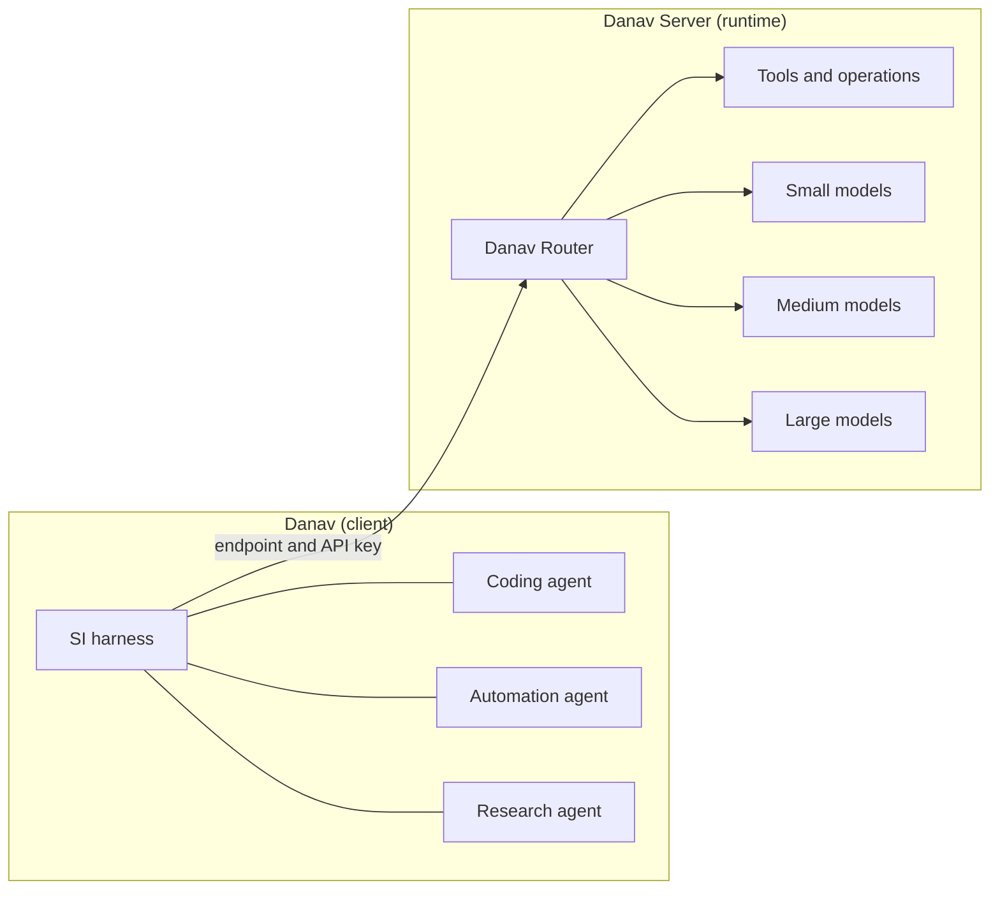

  <picture>
    <source media="(prefers-color-scheme: dark)" srcset="https://github.com/danavsi/danavsi/blob/main/logo-dark.png?raw=true">
    <source media="(prefers-color-scheme: light)" srcset="https://github.com/danavsi/danavsi/blob/main/logo-light.png?raw=true">
    
  </picture>

<h1 align="center">Danav</h1>

<strong>SI you own, on hardware you own.</strong>

  A self-hosted super intelligence (SI) runtime and agent platform. 
  Install any open-source model, run your own agents, and pay for the systems you buy and nothing more.

---

## Overview

Danav is a self-hostable platform for fast, efficient, type-safe and task-oriented intelligence. It covers coding, automation and general-purpose assistance, and it chooses the most suitable model and model size for each request so that small tasks stay fast and larger models run only when the work calls for them.

Both products are self-hosted. You pay for the systems you buy. There is no monthly subscription and no payment to AI companies, because the models run on your own server.

> **Status:** Danav is in design. This repository holds the project landing page. Nothing described here is released software yet.

## Two products

| | **Danav Server** | **Danav** |
| --- | --- | --- |
| Role | The runtime and management platform | The lightweight client |
| Load | Uses the RAM and all the resources of its machine | Light enough for any machine |
| Does | Installs, tunes and runs models, routes requests, issues API keys | Runs your SI harness and agents, and does the work through the server |
| Runs | Same machine as Danav, or a separate local or remote server | Alongside a local server, or connected to any server by endpoint and API key |

The agent names above are examples. In Danav you add an SI harness and create as many agents as you need for your different kinds of work.

### Danav Server

- Install, update, remove and run multiple models, including any open-source model.
- Tune how each model runs for the intended work, for faster results.
- Route requests by intent, complexity, capabilities, latency and available resources.
- Expose secure API endpoints with individually generated API keys.
- Support multiple users, clients, endpoints and access permissions.
- Manage model availability, resource allocation, task execution, logs and usage.

### Danav

- Handle conversation, coding projects, command-line operations and autonomous task workflows.
- Add an SI harness and create multiple agents for different work.
- Understand intent and turn requests into structured, executable tasks.
- Make type-safe tool calls with validated inputs and outputs.
- Execute tasks, inspect results, run tests and recover from failures.
- Connect to different Danav servers using their endpoints and API keys.

## Danav Router

Danav has its own lightweight intent-understanding and routing model. For every request it works through six decisions:

1. What does the person want, and which capabilities does it need?
2. Does it need a model, a tool, a deterministic operation, or a combination?
3. Which installed model is best suited to the task?
4. What is the smallest suitable model and the appropriate compute budget?
5. Should it execute directly, plan, delegate subtasks, or ask for clarification?
6. Is the result correct, and is further work necessary?

The router favors the fastest suitable path, avoids unnecessary reasoning and repeated text generation, and escalates to a more capable model only when required.

## Principles

- **Local-first:** run models on hardware you control, with no mandatory paid AI APIs.
- **Model-agnostic:** support different model families and inference runtimes.
- **Efficiency-first:** optimize response time, memory use and compute cost.
- **Type-safe execution:** structured schemas, validated tool calls, explicit error handling and predictable interfaces.
- **Task-oriented:** finish and verify the work instead of only generating text.
- **Extensible:** add new models, tools, runtimes and capabilities independently of each other.
- **Secure by design:** authenticate clients, scope API keys, enforce permissions and isolate potentially dangerous operations.
